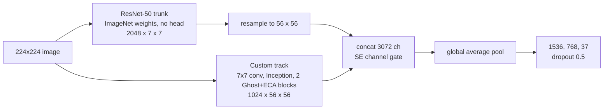
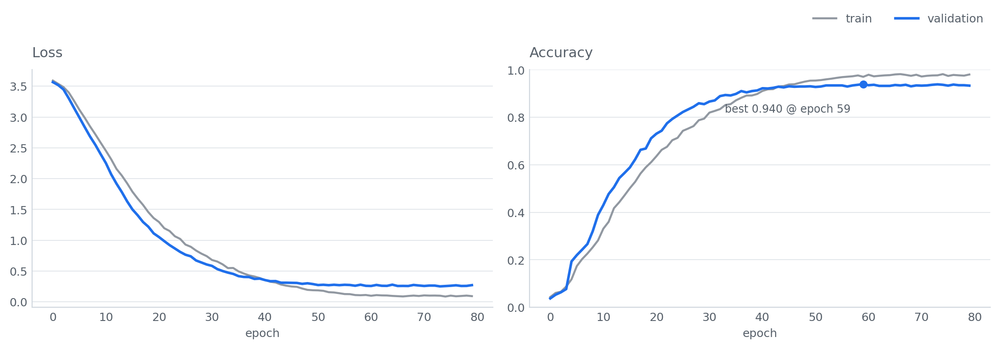
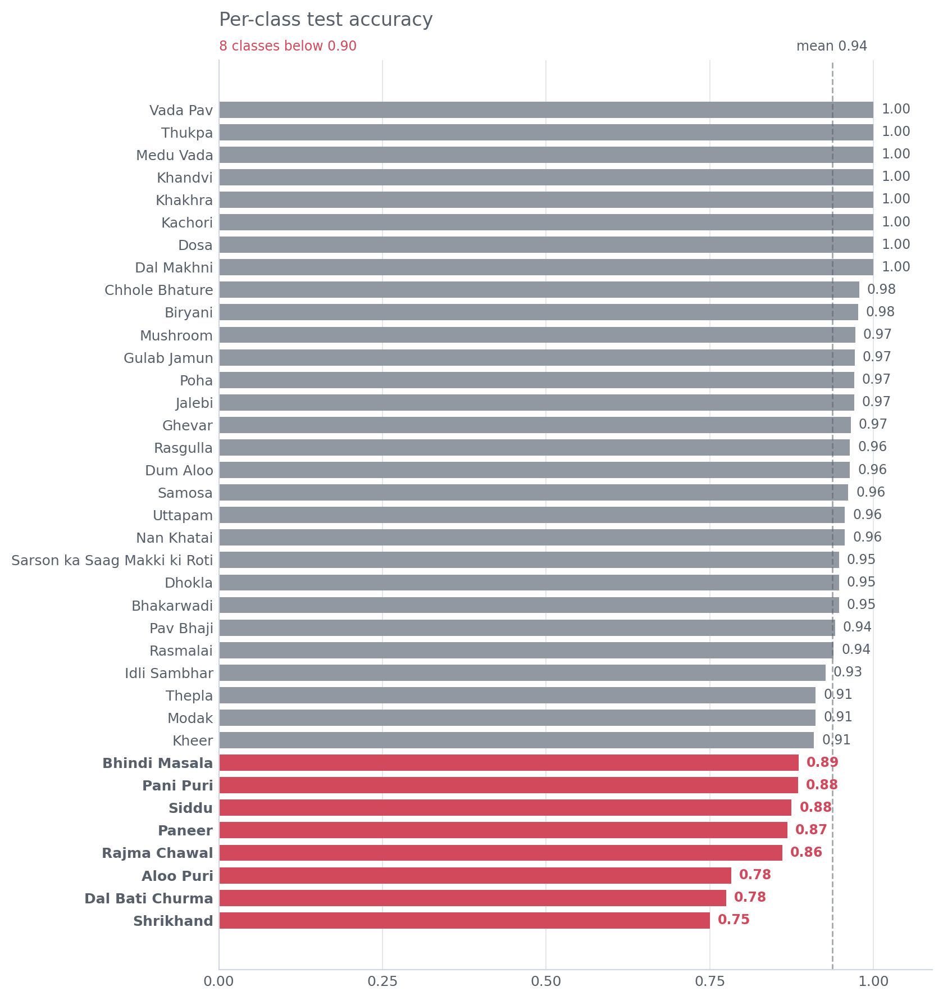
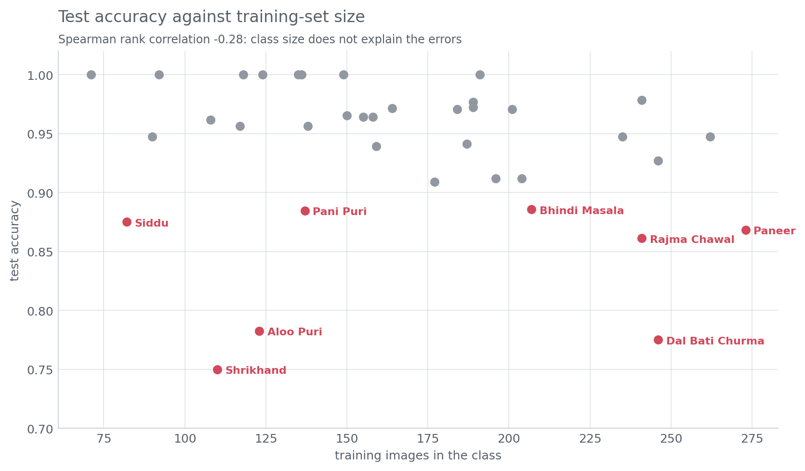
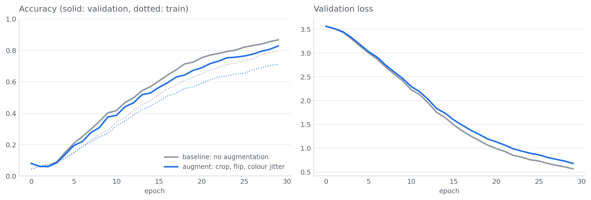

# Indian Food Classifier

Recognises **37 traditional Indian dishes** from images with a two-track
network: a ResNet-50 trunk pretrained on ImageNet, fused with a small custom
CNN, and trained end to end on `ind_food_37`.

| | |
| --- | --- |
| Architecture | Dual-track: ResNet-50 trunk + Inception/Ghost/ECA CNN, SE fusion, 3-layer head |
| Trainable parameters | 39,544,363 |
| Epochs | 80 |
| Batch size | 16 |
| Input | 224×224 RGB |
| Loss | Cross-entropy |
| Optimiser | SGD, lr 1e-3, momentum 0.9 |
| LR schedule | `ReduceLROnPlateau` (factor 0.2, patience 3) |
| **Best validation accuracy** | **0.940** (epoch 59) |
| **Mean per-class test accuracy** | **0.937** |

---

## The model

The notebook calls it `DualTrackModel`, and the parameter count only adds up
for that: a fine-tuned ResNet-50 on its own would be 23.6M with a 37-way head.
Two tracks look at the same 224x224 image.



- **Track 1** is `torchvision.models.resnet50` with the pooling and classifier
  removed, so it contributes a 2048-channel map.
- **Track 2** is a stride-4 CNN: a 7x7 stem, an Inception block, two blocks of
  channel shuffle, a Ghost module and ECA attention, then a 1x1 expansion to
  1024 channels.
- The ResNet map is resampled up to the second track's 56x56, the two are
  concatenated and re-weighted by a squeeze-and-excitation gate, pooled, and
  classified by a three-layer head with dropout.

The definition lives in [`src/indfood/model.py`](src/indfood/model.py), taken
from the notebook unchanged apart from the weights API. Whether the second
track earns its 16M parameters over the plain ResNet-50 is an open question;
the notebook never ran the ablation.

---

## Results

### Training



Validation accuracy reaches **0.940 at epoch 59** and then flattens, while
training accuracy keeps climbing toward 0.97. That gap is the honest read on this
run: the last twenty epochs buy nothing on validation, and the model is starting
to memorise. The checkpoint worth keeping is epoch 59, not epoch 79.

### Per class



Eight classes are perfect on the test split — Vada Pav, Thukpa, Medu Vada,
Khandvi, Khakhra, Kachori, Dosa, Dal Makhni — and **eight sit below 0.90**:

| Class | Accuracy | Likely reason |
| --- | --- | --- |
| Shrikhand | 0.75 | 15/20. A plain bowl of thick white-yellow dairy, visually near Kheer and Rasmalai |
| Dal Bati Churma | 0.78 | A composite plate; the model sees whichever element dominates the crop |
| Aloo Puri | 0.78 | Shares nearly every visual cue with Chhole Bhature |
| Rajma Chawal | 0.86 | Brown curry beside white rice — the generic Indian plate layout |
| Paneer | 0.87 | A label spanning many different dishes |
| Siddu | 0.88 | Only 16 test images, so 14/16 — a noisy estimate |
| Pani Puri | 0.88 | Confused with Kachori and Samosa — all round and fried |
| Bhindi Masala | 0.89 | Dark-green sabzi, close to other dry vegetable dishes |

The pattern is consistent: failures cluster where dishes share **colour and
plating**, not where they are rare. More data alone would not fix Shrikhand; the
fix is harder negatives against the dairy-dessert group.

### Does class size explain it?

No. The training split is unbalanced, from 71 images (Khakhra) to 273
(Paneer), so the obvious suspicion is that the weak classes are the small ones.
The numbers say otherwise.



| | |
| --- | --- |
| Spearman rank correlation, training images vs test accuracy | **-0.28** |
| Mean test accuracy, smallest third of classes | 0.939 |
| Mean test accuracy, largest third of classes | 0.915 |

Four of the eight weak classes (Paneer, Dal Bati Churma, Rajma Chawal, Bhindi
Masala) are among the eight **largest** training classes, and the smallest
class of all, Khakhra, is perfect on the test split. If anything, the big
classes are the ambiguous ones: Paneer and Dal Bati Churma are labels that
cover several different-looking plates. [`results/dataset_stats.py`](results/dataset_stats.py)
counts the dataset, computes the correlation and draws the chart; the counts
are in [`results/dataset_counts.json`](results/dataset_counts.json).

### Does augmentation help? Not in 30 epochs

The original run used no augmentation, and the gap between train and
validation accuracy after epoch 59 looked like the first thing to fix. Two
fresh 30-epoch runs with the packaged trainer compare it directly: the same
recipe, seed and GPU, one with no augmentation and one with random resized
crop, horizontal flip and colour jitter on the training split.



| | No augmentation | Crop, flip, colour jitter |
| --- | --- | --- |
| Best validation accuracy (epoch 29) | **0.868** | 0.829 |
| Test accuracy | **0.877** | 0.831 |
| Mean per-class test accuracy | **0.847** | 0.794 |
| Classes better / worse than the other run | | 5 better, 20 worse |
| Minutes on an RTX 4070 Laptop GPU | 41 | 40 |

At this budget augmentation costs about four points everywhere. It slows
learning rather than curing overfitting: neither run overfits by epoch 29, and
validation accuracy sits above train in both, because dropout is active during
training. The learning rate never dropped in either run, so both were still
climbing when they stopped.

So this does not settle the original question. Augmentation is meant to pay
off late, when the plain run starts to memorise, and that only happens after
epoch 59. The test needs the full 80 epochs for both runs, about two hours
each on this GPU.

The fresh baseline reproduces the published curve: 0.868 validation accuracy
at epoch 29, against 0.855 in the original. Its commonest test errors support
the per-class reading above. Shrikhand goes to Rasmalai and Kheer, and Aloo
Puri goes to Chhole Bhature, which gets eight such errors in the augmented run.

```bash
python -m indfood.train --epochs 30 --amp --workers 4 --out runs/baseline
python -m indfood.train --epochs 30 --amp --workers 4 --out runs/augment --augment
python results/compare_runs.py runs/baseline runs/augment
```

The per-epoch numbers for both runs are in
[`results/augmentation_experiment.json`](results/augmentation_experiment.json).

Raw numbers behind the charts are in [`results/`](results/), and
[`results/make_charts.py`](results/make_charts.py) regenerates the training and
per-class figures from any working directory.

---

## Dataset

`ind_food_37` — 8,395 images across 37 classes, in `ImageFolder` layout.

| Split | Images |
| --- | --- |
| train | 6,185 |
| val | 1,092 |
| test | 1,118 |

```
ind_food_37/
├── train/<class_name>/*.jpg
├── val/<class_name>/*.jpg
└── test/<class_name>/*.jpg
```

<details>
<summary>All 37 classes</summary>

Aloo Puri · Bhakarwadi · Bhindi Masala · Biryani · Chhole Bhature ·
Dal Bati Churma · Dal Makhni · Dhokla · Dosa · Dum Aloo · Ghevar · Gulab Jamun ·
Idli Sambhar · Jalebi · Kachori · Khakhra · Khandvi · Kheer · Medu Vada ·
Modak · Mushroom · Nan Khatai · Paneer · Pani Puri · Pav Bhaji · Poha ·
Rajma Chawal · Rasgulla · Rasmalai · Samosa · Sarson ka Saag Makki ki Roti ·
Shrikhand · Siddu · Thepla · Thukpa · Uttapam · Vada Pav

</details>

Images are resized to 224×224 and normalised with ImageNet statistics, with no
augmentation. Adding it did not help over 30 epochs; see the experiment above.

---

## Setup

```bash
git clone https://github.com/pranavuppuluri/Cooked-Food-Recognition-and-Classification.git
cd Cooked-Food-Recognition-and-Classification

python -m venv .venv && source .venv/bin/activate   # Windows: .venv\Scripts\activate
pip install -r requirements.txt
```

Install `torch` for your own CUDA version from [pytorch.org](https://pytorch.org)
if you want GPU training. On CPU, 80 epochs is not practical.

### Train, evaluate, predict from the command line

The notebook's model and training recipe are packaged under `src/indfood`:

```bash
pip install -e .

# Same recipe as the published run: SGD 1e-3, ReduceLROnPlateau, 80 epochs.
python -m indfood.train --data ind_food_37 --epochs 80 --out runs/baseline
# The same with random crop, flip and colour jitter on the training split.
python -m indfood.train --data ind_food_37 --epochs 80 --out runs/augment --augment

# Per-class accuracy and a confusion matrix on the test split.
python -m indfood.evaluate --weights runs/baseline/best.pth --split test --out results/eval

# Top guesses for your own photos.
python -m indfood.predict --weights runs/baseline/best.pth photo.jpg
```

`train` writes `history.json` in the same shape as `results/training_history.json`
after every epoch and keeps the best-validation weights at `best.pth`. Add
`--amp` on a GPU for mixed precision, and `--workers 4` to load images in
parallel. `evaluate` also reads the full training checkpoints the notebook
saved every nine epochs.

```bash
pip install -e ".[test]"
pytest                 # trains, evaluates and predicts on a tiny synthetic dataset, CPU, ~15s
```

### The notebook

```bash
jupyter notebook notebooks/resnet_food.ipynb
```

It reads `ind_food_37/train` and `ind_food_37/val` directly, so it runs against
the dataset in this repository with no path changes.

---

## Repository layout

```
├── ind_food_37/           # the dataset, ImageFolder layout
├── src/indfood/
│   ├── model.py           # the dual-track network, as the notebook defines it
│   ├── data.py            # ImageFolder loaders, with optional augmentation
│   ├── train.py           # the notebook's training recipe as a CLI
│   ├── evaluate.py        # per-class accuracy and confusion matrix
│   └── predict.py         # classify your own images
├── tests/                 # end-to-end smoke test on a synthetic dataset
├── notebooks/
│   └── resnet_food.ipynb  # the original: training, evaluation and video inference
├── assets/                # figures used in this README
├── results/
│   ├── training_history.json     # 80 epochs of train/val loss and accuracy
│   ├── per_class_accuracy.json   # final accuracy for each of the 37 classes
│   ├── dataset_counts.json       # images per class per split
│   ├── make_charts.py            # regenerates the training and per-class figures
│   ├── dataset_stats.py          # counts the dataset, accuracy vs class size
│   ├── compare_runs.py           # charts two or more training runs side by side
│   └── augmentation_experiment.json  # 30-epoch runs with and without augmentation
├── pyproject.toml
├── requirements.txt
└── LICENSE
```

**What is not here:** trained weights, which are too large for git. The
notebook is where the model was actually built and is exploratory in places;
`src/indfood` is the same model and recipe, tidied into something you can run
and test.

---

## Serve it on the web (HealthNow)

`serve/app.py` is a small Flask app that puts the classifier behind a web page,
deployed as **HealthNow** on the author's own box. It loads
`runs/baseline/best.pth` once on the CPU, serves a phone-friendly page
(`serve/index.html`) for taking or picking a photo, and answers `POST /predict`
with the top guesses.

```bash
pip install flask flask-cors pillow
WEIGHTS=runs/baseline/best.pth PORT=8000 python serve/app.py
# then open http://127.0.0.1:8000/ or POST an image to /predict
#
# optional soft gate: a free try, then a password (kept out of the repo)
# HEALTHNOW_PASSWORD=... HEALTHNOW_FREE_USES=1 PORT=8000 python serve/app.py
```

Every real request is saved under `live_usage/` (the photo in `images/`, the
prediction appended to `predictions.jsonl`), so the repo gathers genuine
in-the-wild examples to review later. The author's instance runs it as a
systemd service on a private Linux box and exposes it publicly with Tailscale
Funnel, linked from the unhuman.in launcher. Anyone may try the
first photo for free; past that the page asks for a password before it keeps
classifying. The password comes from the HEALTHNOW_PASSWORD environment
variable on the box, so it never lives in this repo.

---

## Notes

The notebook also contains a video-inference path that reads a video file,
classifies frames, and writes an HTML summary. It depends on OpenCV and is less
polished than the training code.

If you re-run training, the result worth keeping is the **epoch-59 checkpoint**,
not the final one — see the training curves above.

---

## License

MIT — see [LICENSE](LICENSE).
